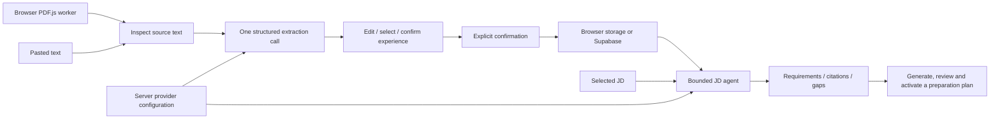

# Resume import with human review

The problem: a manually maintained experience bank is useful for grounded interview preparation, but entering every role from a resume is slow. A model can draft records quickly while also inventing ownership, silently changing dates, or promoting a team outcome into a personal accomplishment. The design makes those interpretations visible before they become evidence for another model.

The diagram below is a simplified original resume-to-analysis flow. For the current system boundaries, target-based preparation lifecycle, authentication, imports, and data relationships, see the [architecture and flow index](docs/architecture/README.md).

Storage and inference are independent choices. Browser persistence can use actual local inference without authentication or Supabase, behind explicit development/loopback/same-origin checks. Hosted access uses Supabase authentication. Ollama is the default fixed-loopback provider; OpenAI uses the existing Agents SDK and remains a server-configured option for both workflows. There is no paid fallback.

The original PDF remains in browser memory. A same-origin PDF.js compatibility module/worker produces text, preserving page references. An inspection step lets the user catch reading-order and missing-text problems before inference. File, page and character limits reject oversized input rather than silently truncating evidence. Scanned documents need pasted text; OCR and DOCX remain deferred.

Extraction makes one schema-constrained model call without tools. The output contains roles/projects, organizations, dates, accomplishments and ambiguity warnings. Resume quotations, citations and page matching were removed after the user found them unnecessary for this workflow. Validation checks field shapes and bounds; the user reviews truthfulness, dates, metrics and ownership before confirmation. The model receives resume text once, without duplicated per-page text. Blank fields stay blank until corrected. JD analysis still references confirmed experience records.

The review interface exposes both structured fields and the title/details actually saved into the existing bank. Likely duplicate roles are deselected initially, while an explicit separate import remains possible. Imported provenance contains role/organization/date fields, model/provider/prompt metadata and confirmation time. Existing records with legacy excerpts remain compatible; new imports do not generate them. Full resume text and original files are not persisted. Drafts are transient; failed saves retain them for retry.

Confirmation uses stable batch/item identifiers. Browser persistence validates the whole selection before one write. Supabase validates through the API and inserts transactionally with per-user locks, ownership from auth.uid(), unique retry keys and a 50-entry database guard. A malformed entry or capacity failure rolls back the entire batch. Prior manual entries remain valid, and historical evidence snapshots remain intact.

JD analysis keeps the two read-only retrieval tools, six-turn and ten-tool limits, schema/reference validation, sanitized failure states, and a preparation plan that stays a draft until activated. Local and cloud transports have explicit deadlines and no SDK retries. Provider tracing is disabled. Simulated preview remains clearly labeled and separate from real inference.

## Evidence and limits

### One preparation target across three views

An application or named group of up to three applications defines a preparation target. A separate, explicit structured call combines current real analyses and referenced experience into questions, answer outlines and estimated activities. Users inspect and edit the output before activating an immutable version. Sources remain job-specific even when a shared activity serves several requirements; experience supporting one job does not automatically support another.

Scheduling is deterministic application logic. It allocates activities by priority into one-/two-week or custom-date budgets and exposes deferred work and uncovered requirements. Interview practice, the weekly schedule and the task checklist all use the same activated version and progress records. This avoids maintaining three unrelated generators or asking the model to perform date arithmetic. Answer feedback remains manual.

Source snapshots and fingerprints allow freshness checks without rewriting historical plans. Activation is transactional and retry-safe; a replacement version starts fresh progress and retains earlier versions read-only. Browser records are additive, while account persistence uses owned tables and a security-definer RPC with explicit ownership checks. Application deletion preserves preparation history; target deletion removes that history. General practice remains a separate option with its existing progress.

Job URL import follows the same inspect–draft–confirm pattern. A server fetches one public HTTPS page with bounded bytes, time and redirects; validates every resolved address; and pins DNS into the socket to prevent a later lookup from reaching a private address. It reads a single structured JobPosting when available, falling back to conservative readable HTML. No browser session or script execution is involved. Users can paste text when a listing needs JavaScript, login or anti-bot access.

Fetching and model extraction are separate actions. Only the inspected text enters one schema-constrained call; users review company, role and JD before saving. The source URL is saved in existing application notes, while intermediate page text/drafts remain transient. Stable application IDs make confirmation retries safe across browser persistence and authenticated creation, without changing existing manual edits. This extends the portfolio's full-stack data flow without adding hosted search infrastructure or autonomous browsing.

Automated checks exercise both real SDK request paths using mocked HTTP, local access boundaries, parser policies, citation-free drafts, idempotency, transactional failure, capacity and PostgreSQL row-level security. These demonstrate software contracts, not Qwen3 extraction quality, browser worker correctness on arbitrary PDFs, hosted Supabase availability, or human interpretation accuracy.

The synthetic extraction dataset defines expected role/organization/date fields plus cases for shared ownership, metrics, prompt injection and projects. The evaluation script records actual run outputs, field/count agreement, forbidden-phrase flags, latency and failures; semantic review is still required. Measured local results and open findings are in [evals/results.md](evals/results.md).

The next evidence to collect is a successful local end-to-end run: synthetic PDF/text import, selected confirmation, persistence after reload, genuine local JD analysis, plan activation, and an Ollama-stop recovery check. Paid OpenAI comparisons are explicitly opt-in. Provider/model choice should follow those measurements.
