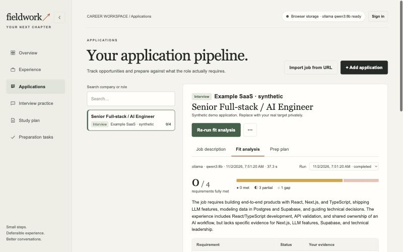
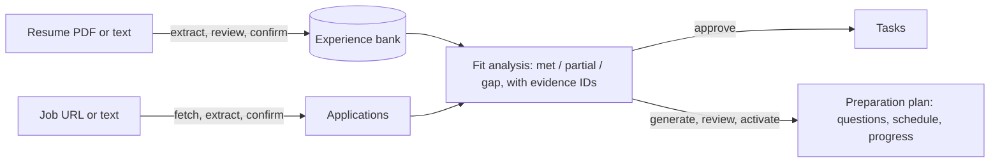

# Fieldwork · Job Search Workspace

**Interview preparation grounded in your real experience.** Import your resume into an experience bank you confirm line by line. Then check each job description against it: every requirement is marked met, partial or gap, and linked to the evidence behind it. Finally, turn those gaps into a scheduled preparation plan you review before anything is saved.





**What makes it different**

- **Nothing the model says is trusted by default.** Output is validated with Zod, and every evidence and requirement ID is checked against the inputs. Drafts stay drafts until you confirm them.
- **Runs locally or hosted.** Local Ollama (`qwen3:8b`) is the default, and OpenAI is an option. Storage is either your browser or a Supabase account protected by row-level security. Storage and model choice are independent.
- **Engineered for failure.** Every model call has a deadline, makes exactly one attempt and has no fallback. Errors are sanitized. Duration and tokens are recorded even when a call fails. Retries are idempotent, and the hosted plan has hourly quotas.
- **Measured.** 401 tests cover routes, UI, Postgres RLS (in PGlite), SSRF-safe fetching and the security headers. Labelled evals cover resume, job and plan generation; see [the results and known weaknesses](evals/results.md).

For a code-guided walkthrough with diagrams, start with the [architecture and flow index](docs/architecture/README.md).

## Quick start

```sh
pnpm install --frozen-lockfile
cp .env.example .env.local   # keep your existing file if you have one
ollama pull qwen3:8b         # optional: real analysis needs a local model
pnpm dev                     # http://127.0.0.1:3000
```

The workspace opens with synthetic sample data in browser storage, and **Simulated preview** shows the full flow without any model. The sections below cover model setup, every flow, and optional Supabase accounts.

## Local setup

Use Node 22.13+ (or a current supported Node 24 release) and pnpm 11.25.0.

```sh
pnpm install --frozen-lockfile
# If .env.local does not already exist:
cp .env.example .env.local
pnpm dev
```

`.env.example` enables the local defaults; preserve any existing `.env.local` rather than overwriting it.

Open **http://127.0.0.1:3000**. The dev script binds to loopback. Existing `fieldwork-demo-v1` browser data is retained. The initial records are synthetic examples; replace them with your own user-confirmed experience. Browser records belong to that browser origin; localhost and 127.0.0.1 have separate storage.

Ollama/model installation is a separate step; the app never downloads a model. Install the macOS application from [Ollama](https://ollama.com/download), open it, then install the starting model:

```sh
ollama pull qwen3:8b
ollama list
```

If `ollama` is not on PATH, the macOS app commonly includes the binary here:

```sh
/Applications/Ollama.app/Contents/Resources/ollama pull qwen3:8b
```

Configure Ollama's server context to **32,768 tokens** for JD analysis. Quit the Ollama app, run this, then reopen it:

```sh
launchctl setenv OLLAMA_CONTEXT_LENGTH 32768
```

This is an Ollama setting, not a Next.js environment variable. The native extraction request sets its context explicitly; the [OpenAI-compatible endpoint cannot set context per request](https://docs.ollama.com/api/openai-compatibility#setting-the-local-context-size). An alternative is to explicitly create the local alias in `setup/Modelfile` and set `OLLAMA_MODEL=fieldwork-qwen3:8b`. This also reuses the downloaded base model. Large banks may still exceed the available context; keep experience focused and review coverage.

This is a several-GB download. Qwen3 8B is a starting configuration for the M2 Pro/32 GB machine, **not a measured quality or latency recommendation**. The fixed inference address is `http://127.0.0.1:11434`. Models routed to cloud services are outside this local workflow.

The interface shows the active provider/model and a refreshable readiness check. Ollama readiness checks installation via `/api/show`; OpenAI readiness means a server key is configured, not that account access has been verified.

## Import a job listing

In **Applications → Import job from URL**, paste a public HTTPS listing and choose **Fetch page**. Inspect and edit the extracted text before choosing **Extract job details**. Review the company, role and complete JD, then choose **Confirm and save application**. The new application starts at Saved; its final source URL is retained in notes. Only confirmation writes an application. Closing the dialog discards transient source/drafts, while a failed save keeps the review available for retry.

This uses direct server-side page fetching, not Ollama's hosted web search. No search account, API key, browser permission, or additional package is required. Job extraction uses the same `AI_PROVIDER` / model configuration as resume extraction, with a single structured call and no automatic retry or paid fallback. Only inspected page text is sent to the model; the experience bank is not included. You can also paste text or enter details manually without an inference call.

The fetcher prefers a single JSON-LD JobPosting, otherwise readable HTML/main/article content. This is conservative text extraction, not a browser renderer. Login walls, anti-bot restrictions, JavaScript-only pages, compressed responses and unsupported content can require the pasted-text fallback. Review for missing or unrelated sections. Limits: HTTPS on the default port, 15-second fetch, three redirects, 2 MB page, 30,000 source characters; saved JD limit remains 15,000. Oversized fetched content is rejected rather than silently truncated.

For `jobs.gem.com/<board>/<job-id>` pages with insufficient HTML text, the importer also tries [Gem's public Job Board API](https://api.gem.com/job_board/v0/reference). It requests the individual posting, with a board-list lookup only after an individual-posting 404. Results must uniquely match the exact job ID or listing URL; other jobs are never sent to the model. The original listing URL stays in application notes. All requests share the 15-second deadline and existing network/size guards; redirects are limited per resource. Unknown response shapes and unavailable descriptions retain the pasted-text fallback. This adapter is covered with mocked responses; acceptance against the reported live Gem listing remains pending.

Fetch/extraction endpoints use the existing authenticated or explicitly enabled development/loopback/same-origin access guard. Every redirect is checked; private/reserved addresses are denied and validated DNS is pinned to the connection. No browser cookies, session credentials, scripts, embedded resources or page links are loaded. No database migration is needed; both browser storage and Supabase use a stable creation ID to prevent duplicate applications on confirmation retries. A separate intentional import can still create another application.

## Resume → evidence → JD → approved tasks

1. Open **Experience → Import resume**. Upload one text-based PDF (5 MB, ten pages), or paste up to 20,000 characters.
2. Inspect the actual extracted text before sending it to the configured model. Compare columns, dates, missing pages and characters with the original. Switch to pasted text to correct parsing problems.
3. Generate drafts. Review each role/project, edit the saved title/details and structured fields, and confirm that dates, metrics and ownership match your actual work. Missing fields stay empty. Resume citations and page matching are not requested or required.
4. Select entries and confirm. Likely duplicates start deselected. Checking a duplicate explicitly imports a separate record; no merge/overwrite occurs. Selected entries and import metadata are saved; PDF files and complete extracted resumes are not stored. Cancel/reload discards unconfirmed drafts. A failed save retains drafts and stable confirmation identifiers for retry.
5. Add a job under **Applications**, select it in the list, and choose **Analyze fit**. The **Fit analysis** tab shows requirement coverage (met / partial / gap) with the evidence behind each match; review it, then approve the plan from **Prep plan**. Generated tasks are proposals until approval. **Simulated preview** (in the ⋯ menu) is an explicit separate option that makes no model call.

The PDF is parsed in browser memory with the PDF.js compatibility ESM module and its same-origin worker. Only extracted text/page text is sent to the backend. Encrypted, malformed, scanned/empty, oversized, and partially unreadable documents get errors or warnings with a pasted-text fallback. OCR and DOCX are deferred. Multi-column ordering is not certified automatically.

The bank supports 50 entries. Local confirmation writes the complete validated batch once; Supabase uses a transaction, per-user lock, and uniqueness constraints. Confirmation retries do not overwrite previously saved entries.

## Job-specific preparation targets

Choose **Applications → ⋯ → Prepare for this job**, or open Interview practice and choose **Create preparation group** for one to three applications. The shared **Preparing for…** selector controls Interview practice, Study plan, and Preparation tasks. General practice retains your existing questions, notes, self-scores and general roadmap; old date-specific wording is removed. Selection is remembered separately for browser storage and each account.

1. Complete a current **real** analysis for every selected job. The setup shows missing/outdated analyses with explicit Run real analysis buttons; nothing runs just from selecting a target. Old browser runs without a saved JD snapshot need re-analysis once. Simulated previews cannot feed real preparation generation.
2. Choose start date, **one week**, **two weeks**, or an interview date, and 0.5–40 hours/week. Defaults are today, one week and 12 hours/week. The interview day is included; partial weeks are prorated. Specific dates may be up to one year from the start.
3. Choose **Generate preparation plan**. One structured provider call combines requirements, analysis questions/tasks and referenced experience into questions with suggested answer outlines and prioritized study/practice activities. No browsing, grading, tools, tracing, automatic retry, download or provider fallback occurs. The serialized model input is limited to 60,000 characters without silent truncation; narrow an oversized target or shorten experience and re-analyze.
4. Review questions/outlines, edit activities and estimates (5–120 minutes), change priority, deselect activities, and adjust timing. The schedule recalculates locally without another inference call. Activities are allocated in priority order, preserving input order for ties; indivisible activities that cannot fit any weekly bucket go to **Deferred**. Uncovered requirements are visible.
5. Choose **Activate plan**. Interview practice uses its questions and source evidence; written answers and self-review scores save automatically shortly after you stop typing. Study plan and Preparation tasks share the same completion records, including job/type/status task filters. Writing an answer does not complete a rehearsal. Deferred work is kept outside schedule totals. Earlier approved analysis tasks remain separate from the new schedule.

Changing sources, target membership or timing never rewrites an active plan. Generate, review and activate a new version explicitly. Old versions retain their notes/scores/completion and are read-only; progress is not transferred automatically. Failed saves retain the review; activation retries do not duplicate versions or reset progress. Closing/reloading discards unactivated drafts and answer edits typed in the last moment before autosave. A target deletion removes its versions/progress, while deleting an application retains preparation snapshots and marks affected membership as needing repair.

Browser preparation is stored additively under `fieldwork-preparation-v1`; prior `fieldwork-demo-v1` and `fieldwork-practice-*` keys are unchanged. Account storage requires **`supabase/migrations/004_preparation_targets.sql`**, applied after 001–003. It adds per-user target/version/progress tables, immutable plan records and transactional activation/progress RPCs. Apply this in your Supabase project before using signed-in preparation; no migration or Supabase is required for browser mode. No service-role key is used.

API additions: `GET/POST /api/preparation` for authenticated storage, and `POST /api/preparation/generate` for guarded inference. Account generation loads owned sources on the server, ignoring caller-supplied snapshots. Browser inference uses the existing explicitly enabled development/loopback/same-origin guard. Plan versions retain source analyses, JD/experience snapshots and SHA-256 fingerprints, timing, provider/model/prompt metadata, and stable question/activity identifiers.

## Provider configuration

```dotenv
AI_PROVIDER=ollama
OLLAMA_MODEL=qwen3:8b
LOCAL_WORKSPACE_ENABLED=true
```

`LOCAL_WORKSPACE_ENABLED` defaults to **disabled** unless explicitly set. Anonymous inference additionally requires `NODE_ENV=development`, loopback hosting, a matching origin, and no external forwarding/hosting indicators. `pnpm start` and hosted production deployments require authenticated Supabase access even if this flag is copied. Do not expose the development server through a tunnel/proxy.

For OpenAI, change the server configuration and restart:

```dotenv
AI_PROVIDER=openai
OPENAI_API_KEY=your-server-key
OPENAI_MODEL=your-account-model
```

Use a model supporting structured output and function tools. OpenAI usage is billed to that key. No browser-visible server keys, automatic fallback, SDK retries, or model downloads are implemented. Local runs use a 180-second total deadline; OpenAI uses 45 seconds. JD analysis retains six turns, ten read-only tool executions, output validation and manual task approval. Ollama receives the validated JD/experience snapshot in its initial message, so a structured response without tool calls still has the selected data and exact evidence IDs. The same read-only tools remain available; tool execution is not guaranteed. Analysis errors distinguish timeout, invalid JSON/tool responses, schema/reference failures and the turn limit. Extraction uses one structured model call and no tools. Tracing is disabled. Extraction errors distinguish connection, model, timeout, JSON/schema failures without echoing model output. Provider errors are sanitized; resume/JD contents are not logged by the app.

## Use your own OpenAI key

On a hosted copy, visitors without an account can run every AI step on their own OpenAI key. Open the model status in the header, choose **Use your own OpenAI key**, paste the key and choose **Check key**. The app lists the key's models through OpenAI's free `GET /v1/models`, so a wrong or restricted key is caught before any billed call. The visitor then picks from the models that key can use **and** that the app has a price for, cheapest first (`gpt-6.1-terra` is suggested). A visitor's key can only run priced models, so every call shows its cost; models the key has but the price table doesn't cover are named, not offered. Prices stay in a dated table because OpenAI has no prices API.

- **Where the key goes.** It is kept in this browser: in `sessionStorage` until the tab closes, or in `localStorage` with **Remember on this device**. **Forget key** removes it. It is sent to this app's own API routes in an `x-openai-key` header with each AI request, used for that one OpenAI call, and never stored, logged or returned. The server's config object holds it as a non-enumerable field, so it cannot leak into a response or stored record.
- **What it unlocks.** Resume import, job extraction from pasted text, fit analysis and plan generation. Importing a job **from a URL** still needs an account, since any string would pass as a key and turn the server into an open URL fetcher. Calls on a visitor's key don't count against the hosted hourly quotas.
- **Errors.** OpenAI's 401, 429 and 404 answers become `openai_key_rejected`, `openai_rate_limited` and `openai_model_unavailable`. OpenAI's own error text is never forwarded, because it can quote the key.

### Security model

A visitor's key lives in their browser and passes through this app's server, so the design assumes three threats:

| Threat                                                | What protects the key                                                                                                                                                                                                                                                                                                                                                                                                                                                                                                                                                                                                      |
| ----------------------------------------------------- | -------------------------------------------------------------------------------------------------------------------------------------------------------------------------------------------------------------------------------------------------------------------------------------------------------------------------------------------------------------------------------------------------------------------------------------------------------------------------------------------------------------------------------------------------------------------------------------------------------------------------- |
| A script injected into the page reads browser storage | A strict, per-request Content-Security-Policy ([`proxy.ts`](proxy.ts), [`lib/security-headers.ts`](lib/security-headers.ts)): scripts run only with that request's nonce, inline event handlers and `eval` are blocked in production, and network calls may go only to this site and Supabase. The app loads no third-party scripts and never renders raw HTML; React escapes model output. The key is kept only until the tab closes unless the visitor asks to remember it. The policy stops injected markup from running code; like any CSP with `'strict-dynamic'`, it can't contain a script that is already running. |
| The server keeps or leaks the key                     | It's used for one OpenAI call per request and never stored, logged or returned (a non-enumerable config field, sanitized errors, tests that check responses never contain it). The code is public, so this can be checked.                                                                                                                                                                                                                                                                                                                                                                                                 |
| The visitor shouldn't have to trust any of the above  | The key form recommends a **project-scoped key with a monthly budget**, revoked afterwards, so the worst case is capped.                                                                                                                                                                                                                                                                                                                                                                                                                                                                                                   |

This differs from OpenAI's warning against keys in browsers, which is about a developer shipping _their own_ key to every visitor. Here each visitor's key stays in their own browser. Other headers on every response: `X-Content-Type-Options: nosniff`, `X-Frame-Options: DENY` (with `frame-ancestors 'none'`), `Referrer-Policy: same-origin`, a restrictive `Permissions-Policy`, and HSTS. The page is rendered per request so each response gets its own nonce.

### What each step costs

Every step has a fixed reply limit, so the app shows the most a step can cost before you run it ("at most ≈ $0.03"), and the actual tokens and cost after. The model panel shows the price per 1M tokens and a running total for the session. Prices come from a table in [`lib/pricing.ts`](lib/pricing.ts), checked against [OpenAI's pricing page](https://developers.openai.com/api/docs/pricing) on the date it records; models not in the table show tokens only. OpenAI's usage dashboard is the actual bill.

| Step             | Sends                                                      | Reply limit           | Ceiling                                              |
| ---------------- | ---------------------------------------------------------- | --------------------- | ---------------------------------------------------- |
| Resume import    | the inspected resume text                                  | 6,500 tokens          | 1 call                                               |
| Job extraction   | the inspected listing text                                 | 5,500 tokens          | 1 call                                               |
| Fit analysis     | the JD and your experience bank                            | 4,500 tokens per turn | up to 6 agent turns, each resending the conversation |
| Preparation plan | the target jobs, their latest analyses and your experience | 10,000 tokens         | 1 call                                               |

Estimated cost = (instructions + source characters ÷ 4) × input price + reply limit × output price, per turn. Real calls usually stay well below the ceiling, especially fit analysis. Failed calls are shown and counted too, since OpenAI may still bill them.

## Optional Supabase storage / hosted use

1. Create a project at [Supabase Dashboard](https://supabase.com/dashboard/new). Use a personal Free organization for this development setup, name the project `job-search-workspace`, choose a nearby region, and generate/save the database password in your password manager. The app does not need that password. Leave the Data API enabled; this app uses the public schema with explicit grants and row-level security.
2. In the project's SQL Editor, apply **each migration once, in order**: `001_workspace.sql`, `002_resume_import.sql`, `003_resume_without_citations.sql`, **`004_preparation_targets.sql`**, then **`005_inference_usage.sql`** from `supabase/migrations/`. Run one file at a time and stop on an error. For an existing project, apply only migrations not already installed; do not rerun 001 or reset tables.
3. Under Authentication, enable email/password sign-up and leave email confirmation enabled. In URL Configuration, set **Site URL** to `http://127.0.0.1:3000` and add `http://127.0.0.1:3000/**` to allowed redirect URLs. If you intentionally use `localhost`, also add `http://localhost:3000/**`; browser records on that origin remain separate. Signup requests explicitly return to the origin where the app was opened. Use exact production URLs when deploying.
4. Copy the **project URL** and **publishable key** (`sb_publishable_…`) from the project's Connect dialog into `.env.local`, preserving the existing model settings:

   ```dotenv
   NEXT_PUBLIC_SUPABASE_URL=https://your-project.supabase.co
   NEXT_PUBLIC_SUPABASE_PUBLISHABLE_KEY=sb_publishable_your_key
   ```

   These values are public client configuration. A legacy `anon` key is also supported. Never put a secret/service-role key or a database password in a `NEXT_PUBLIC_*` variable. Invalid or incomplete settings show a configuration message while browser storage remains available. `.env.local` is ignored by Git.

5. Restart `pnpm dev` because Next's public configuration is included in the client bundle. Open `http://127.0.0.1:3000`, choose Sign in → Create account, then follow the confirmation email back to the app. If confirmation does not start a session, sign in with the same email/password.
6. Verify account storage with a synthetic experience and application: save both, reload, sign out, and sign back in. Browser records should reappear on sign-out; account records should reappear on sign-in. A second account must see an empty private workspace. Then run a real analysis and exercise target creation, plan activation, and progress saving to check migration 004.

Supabase here provides hosted authentication and database persistence. Keep `AI_PROVIDER=ollama` while Next runs on your laptop; the database does not run the model. A hosted Next server's `127.0.0.1` is that server, not your laptop; choose an available server-side provider such as OpenAI for a normal Vercel deployment. No cloud model hosting is provisioned here.

If email confirmation returns to the wrong host, check Site URL, the redirect allowlist, and your browser origin. If account creation reports an email rate limit or delivery failure, check the project's Auth logs/email configuration and retry after the reported delay; the app does not automatically retry sign-ups. If sign-in succeeds but data reads fail, confirm all five SQL migrations finished successfully and the Data API exposes the public schema. Setup references: [Next.js project configuration](https://supabase.com/docs/guides/getting-started/quickstarts/nextjs), [Auth redirects](https://supabase.com/docs/guides/auth/redirect-urls).

Migration 003 removes the required resume excerpts from the import RPC while preserving existing records. Apply it after 002 if upgrading an existing Supabase workspace. Browser storage needs no migration.

Migration 002 is additive for data: existing manual experience and analysis history remain valid. It adds optional provenance/import identifiers, retry uniqueness, a database capacity guard, provider metadata, a transactional `import_resume_experience` RPC, and a five-minute stale-analysis cutoff. The reservation RPC gains an optional fourth provider argument; existing three-argument callers still work. Back up your database and apply once through migrations; do not rerun migration 001 against an existing database.

Only the publishable Supabase key and user token are used; no service-role key. Ownership comes from `auth.uid()`, with row-level security and authenticated function grants. Historical analyses keep their evidence snapshots. Authenticated analysis quota remains ten runs/hour across job deletion. Migration 005 adds hourly quotas for hosted resume extraction (10), job extraction (20) and plan generation (10); see [model calls](docs/architecture/model-calls.md). Sign-in switches storage rather than automatically migrating browser records to an account.

## Checks and evaluation

```sh
pnpm format:check
pnpm typecheck
pnpm test            # or pnpm test:coverage
pnpm build
```

`pnpm check` runs typecheck, tests and build. CI also runs `format:check` and coverage. Tests cover API routes, the shell and key views in jsdom, both SDK transports with mocked HTTP, provider and access boundaries, PDF parsing, retry safety, database transactions, RLS, capacity and quotas (PGlite), and the eval scorers.

Labelled **synthetic** evals run against the configured provider, one call at a time:

```sh
pnpm eval:resume   # 8 resume cases: dates, multiple roles, projects, ownership, injection
pnpm eval:job      # 8 job pages: noise, injection, sidebars, missing names, embellishment
pnpm eval:prep     # 3 plan cases: single job, combined jobs, tight budget
```

Results go to the ignored `evals/results/`. Each record has scores, latency and tokens. [`evals/results.md`](evals/results.md) records the latest local Ollama run and the weaknesses it found. String matching is a heuristic, so review outputs before citing numbers.

Billed comparisons with OpenAI require an explicit opt-in:

```sh
# Select OpenAI in .env.local first. These commands incur API usage.
pnpm eval:resume --allow-paid
pnpm eval:live --allow-paid
```

The JD comparison performs baseline and grounded runs across 20 cases, 40 model runs in total. No model eval runs in tests or CI.

## Deploying

Any Next.js host works with Supabase accounts and `AI_PROVIDER=openai`. A hosted server cannot reach a laptop's Ollama. Hosted AI steps need sign-in or the visitor's own OpenAI key; the local, account-less mode is refused outside loopback development. With no environment variables at all, a hosted copy still runs: browser storage, Simulated preview, and AI steps on visitors' own keys. Set the Supabase URL and publishable key, `OPENAI_API_KEY` and `OPENAI_MODEL` as server environment variables, apply migrations 001–005, and add the deployed URL to Supabase's redirect allowlist. No demo deployment is maintained.

## Implementation map

- `app/api/*/route.ts`: thin handlers that parse input, check access and quota, call `lib/`, and return JSON.
- `lib/model-call.ts`: the one structured model-call path. Callers are `lib/resume-extraction.ts`, `lib/job-extraction.ts` and `lib/preparation-generation.ts`. Fit analysis is `lib/agent.ts` (Agents SDK).
- `lib/domain.ts`, `lib/resume.ts`, `lib/preparation-plan.ts`: schemas, validation, local reducers and the deterministic scheduler.
- `lib/job-page.ts`, `lib/pdf-text.ts`, `lib/pdf-browser.ts`: SSRF-safe page fetching and PDF text extraction.
- `lib/store/`, `lib/api-client.ts`: browser and account storage behind one interface.
- `lib/user-key.ts`, `lib/pricing.ts`: a visitor's own OpenAI key, prices, cost ceilings and the session total.
- `proxy.ts`, `lib/security-headers.ts`: the per-request Content-Security-Policy and the security headers on every response.
- `components/workspace.tsx`: the shell. It uses `components/hooks/` (data, model status, practice notes, nav), `components/shell/`, `components/views/` and `components/modals/`.
- `components/applications-view.tsx`: application list, fit analysis and plan approval.
- `components/preparation-workspace.tsx` and `components/preparation/`: targets, plan generation, review, practice, schedule and tasks.
- `components/job-import.tsx`, `components/resume-import.tsx`: the import wizards.
- `supabase/migrations/001–005`: tables, RLS, transactional RPCs and quotas.
- `evals/`, `scripts/evaluate*.ts`: labelled cases, scorers and the eval harness.
- `lib/sample-practice.ts`: the sample general-practice content. Replace it with your own.

PDF.js 5.6.205 is vendored as a browser-only package because registry access was unavailable during implementation. Its Apache-2.0 license, upstream attribution and update notes are in `vendor/pdfjs/`; the module and worker are served directly from versioned local assets to avoid rebundling PDF.js’s internal runtime, and fonts/CMaps/WASM are served from `public/pdf-assets`. No CDN code is loaded.

PDF ingestion and inference are separate so parsing errors can be diagnosed without a model call. Portfolio rationale and remaining evaluation work: [CASE-STUDY.md](CASE-STUDY.md).
