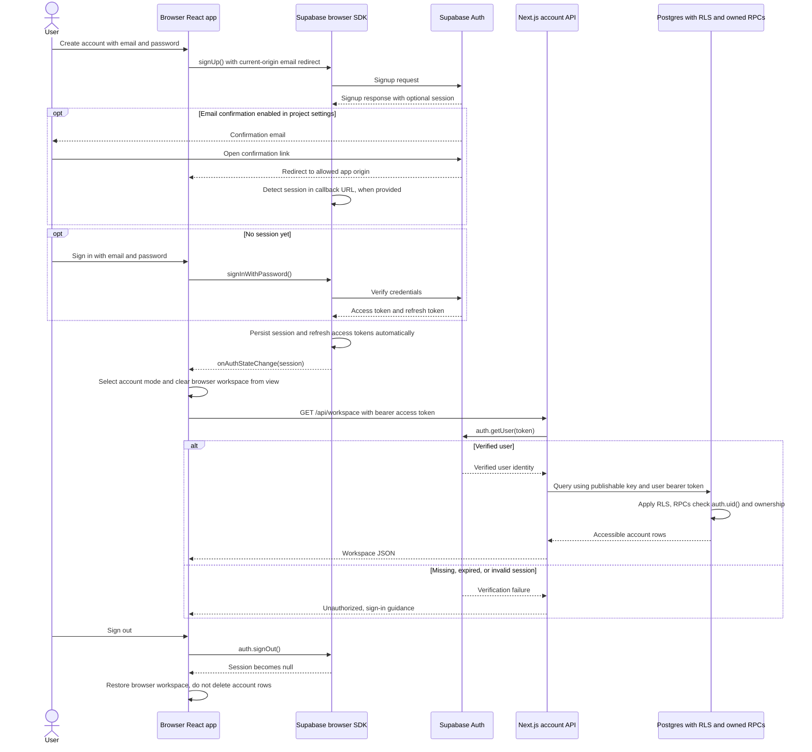

# Authentication and account access

[Architecture index](README.md)

## How to read this diagram

Identity is managed by Supabase Auth. Application APIs verify the user and then
access Postgres with that user's token. The publishable project key is not proof
of user identity and does not bypass row-level security (RLS).

## Session and storage boundaries

- Browser initialization validates public Supabase settings and creates a
  `supabase-js` client. SDK defaults enable session persistence, token refresh and
  URL session detection with implicit flow. This app does not implement server
  authentication cookies or an SSR PKCE callback route.
- Password submission goes from the browser SDK to Supabase Auth. App API calls
  use `Authorization: Bearer <user-access-token>`. Server clients disable their
  own session persistence/refresh and call `auth.getUser(token)` for verification.
- Auth-state changes drive `mode`; browser and account records are not merged or
  migrated automatically. General-practice notes remain local even for accounts,
  under separate browser/account keys. Target-specific preparation is account
  persisted when signed in.
- The server verifies identity; RLS and explicitly owned database functions
  enforce record access. An API call does not acquire a service-role credential.
  Configuration rejects secret/service-role keys in the public-key setting.
- Supabase signup availability, confirmation email delivery, confirmation
  requirements and allowed redirects are external project settings, not guarantees
  made by this code. Signup without a session displays confirmation/sign-in
  guidance. Use the [setup checklist](../../README.md#optional-supabase-storage--hosted-use).

Unauthenticated development inference is a separate access mode, not a Supabase
anonymous user account. It requires the explicit local guard and does not grant
account database access. An account request with an invalid bearer token fails;
it does not fall back to anonymous access.

## Implementation

- [Browser client, auth subscription and sign-in form](../../components/workspace.tsx),
  [public configuration validation](../../lib/supabase-config.ts), and
  [server identity/access checks](../../lib/server.ts).
- [Workspace API](../../app/api/workspace/route.ts),
  [preparation API](../../app/api/preparation/route.ts),
  [base RLS](../../supabase/migrations/001_workspace.sql), and
  [preparation RLS/RPC](../../supabase/migrations/004_preparation_targets.sql).
