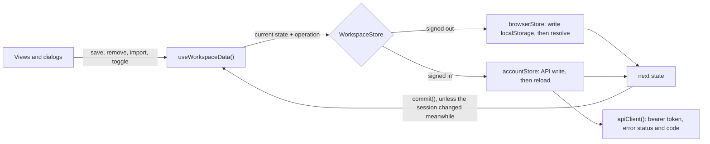

# Client data

[Architecture index](README.md)

## How to read this diagram

The UI never chooses between localStorage and the API itself. The shell holds a
single copy of the workspace, and a `WorkspaceStore` turns each operation into
the next state.

## Behaviour

- **Retries are idempotent.** A new record gets its ID when the form opens
  (`createId`). Retrying a save that already reached storage does not create a
  duplicate, in the browser or in Postgres.
- **One write per change.** The browser store persists before it resolves, so a
  failed write leaves the form open for retry. A running browser analysis
  persists its progress through `update()`.
- **Stale sessions are ignored.** A result that arrives after sign-in or sign-out
  is dropped rather than shown in the other workspace.
- **Checkboxes update at once.** A task shows its new state immediately and saves
  in the background. If the save fails, only that task reverts, and only its own
  checkbox is disabled meanwhile.
- **Edits keep their place.** Editing a job or experience entry does not move it
  in the list.

The preparation workspace uses the same `apiClient()`. It keeps its own targets,
plan versions and progress, because those are versioned and validated separately
(see [preparation lifecycle](preparation-lifecycle.md)).

## Implementation

- [Store](../../lib/store/index.ts), [API client](../../lib/api-client.ts),
  [shell data hook](../../components/hooks/use-workspace-data.ts).
- Tests: [stores and client](../../tests/store.test.ts),
  [shell behaviour](../../tests/ui/shell.test.tsx).
