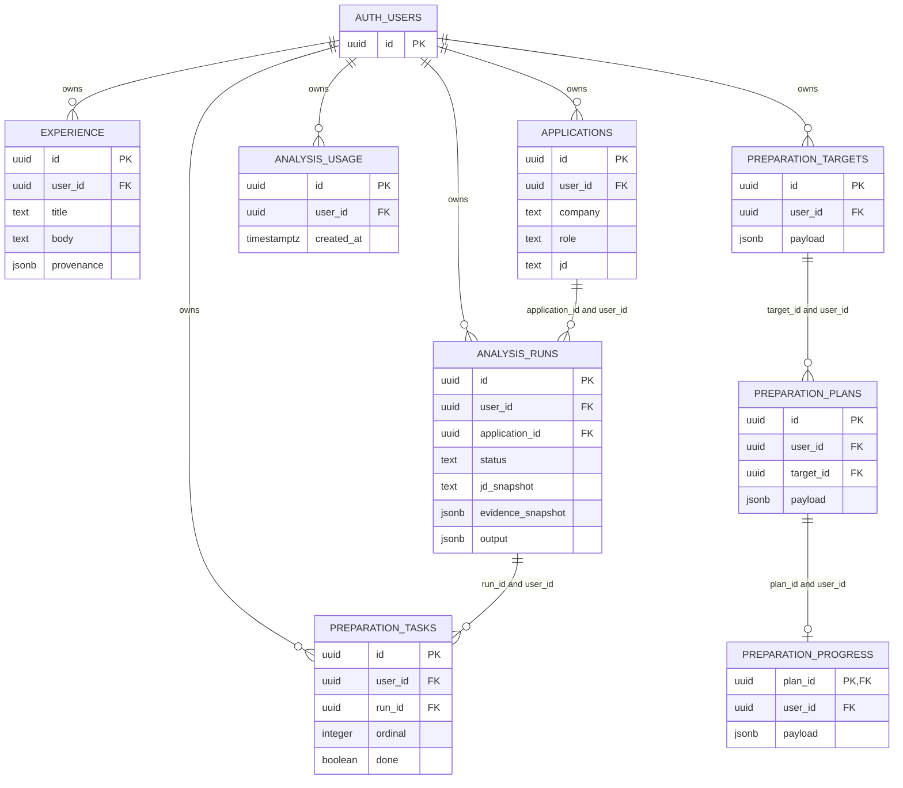
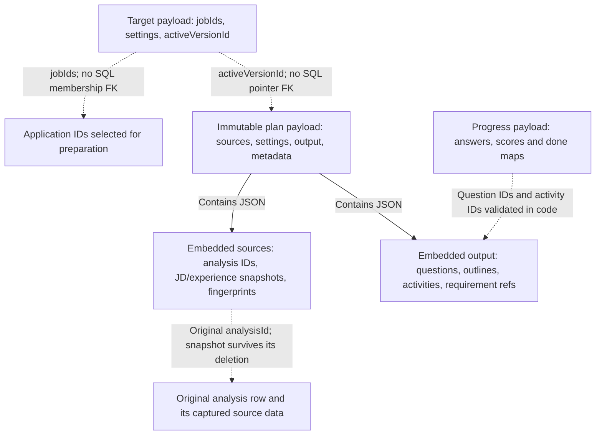

# Data model: physical rows and logical snapshots

[Architecture index](README.md)

## How to read these diagrams

The ER diagram shows actual database tables and foreign keys. Attributes are a
selected subset, not a complete SQL schema. The second diagram describes JSON
contents and application-level references; dotted arrows there are **not foreign
keys**. Questions, activities and target membership are not separate SQL tables.

Composite foreign keys include `user_id` to bind related rows to the same owner.
Plans and progress inherit user ownership through those composite relations;
neither has a separate direct `auth.users` foreign key. A progress row belongs to
exactly one plan. The schema permits a plan with no progress row; the activation
RPC creates one together with each plan, so normal application activation is
one-to-one. RLS controls account reads; mutation RPCs check authenticated ownership
and expose only the intended transitions.

## Snapshots, status, and history

Analysis captures the JD and user-confirmed experience used by that run; later
experience edits do not rewrite the captured result. Requirement/evidence IDs in
analysis output are validated against that run's snapshot, not enforced by SQL
foreign keys to experience rows.

A plan retains source analysis IDs, analysis outputs, JD/experience snapshots and
fingerprints. Its output stores questions and activities inside JSON. The target's
active-version pointer and comparisons with current inputs determine active,
previous and outdated views; there is no plan-status column or enum. Notes,
self-scores and completion live separately in progress keyed by item IDs. SQL
owns/version-links these rows; the API validates their JSON item references.

The earlier `preparation_tasks` table is a different mechanism: approving an
analysis inserted tasks by `(run_id, ordinal)`. The app no longer creates these
rows (approval was retired on 2026-11-05), but existing ones stay readable and
can still be ticked off. They are not the activities inside a preparation plan
and are excluded from its time budget.

## Deletion and retry behavior

| Operation                  | Actual effect                                                                                                                                                                               |
| -------------------------- | ------------------------------------------------------------------------------------------------------------------------------------------------------------------------------------------- |
| Delete experience          | Removes the live entry; captured analysis/plan experience remains embedded.                                                                                                                 |
| Delete application         | Cascades its analysis runs and earlier approved tasks; the separate quota ledger survives. Target job IDs may become dangling logical references, but saved plan snapshots/progress remain. |
| Delete target              | Cascades its plan versions and their progress; applications and earlier analysis tasks remain.                                                                                              |
| Activate replacement       | Inserts an immutable version and fresh progress, changes the target pointer, and retains previous versions read-only.                                                                       |
| Retry committed activation | Existing owned version ID returns without overwriting history, resetting progress or reactivating an older version.                                                                         |
| Delete Auth user           | Direct ownership cascades remove owned application data and targets; composite cascades also remove plans/progress. The app has no account-deletion UI.                                     |

Resume imports have unique `(user_id, import_batch_id, import_item_id)` identifiers.
Earlier task approval has unique `(run_id, ordinal)`. Stable plan IDs and the
activation RPC provide new-plan retry safety. These are separate idempotency
mechanisms for separate writes.

Browser mode uses localStorage rather than these physical tables: main records
use `fieldwork-demo-v1`, target plans/progress use `fieldwork-preparation-v1`, and
general-practice notes use separate browser/account keys. Logical snapshots and
validation apply in both modes, but database RLS applies only to database access.

## Implementation

- [Base schema, RLS, quota ledger and earlier tasks](../../supabase/migrations/001_workspace.sql),
  [import/provider additions](../../supabase/migrations/002_resume_import.sql),
  [citation-free import compatibility](../../supabase/migrations/003_resume_without_citations.sql),
  [target/plan/progress tables and mutation RPC](../../supabase/migrations/004_preparation_targets.sql).
- [Core record types](../../lib/domain.ts),
  [resume provenance and import IDs](../../lib/resume.ts),
  [plan/progress JSON and validation](../../lib/preparation-plan.ts), and
  [account mutation validation](../../app/api/preparation/route.ts).
