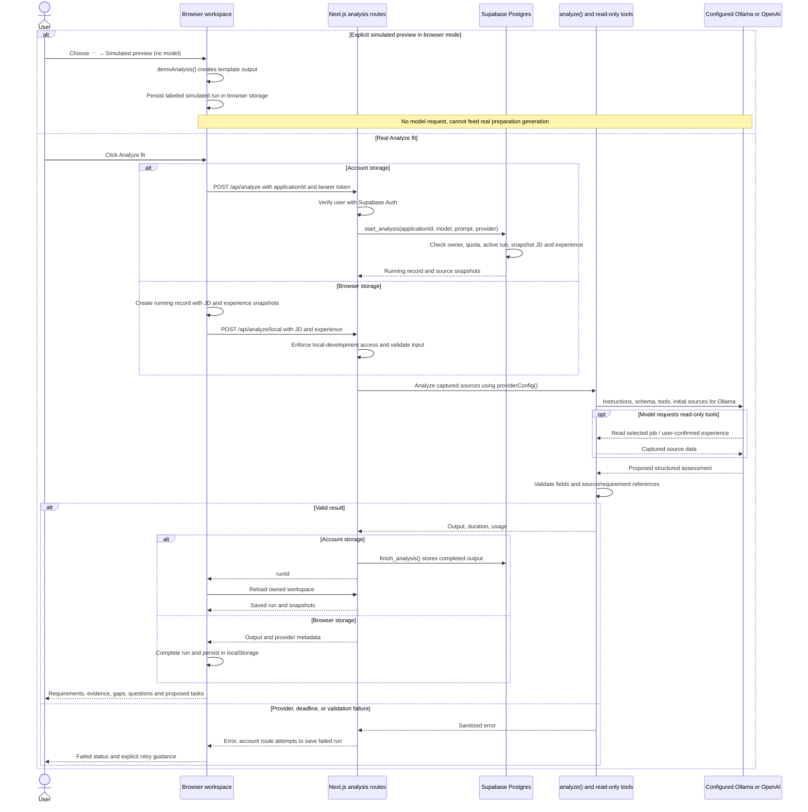

# Fit analysis

[Architecture index](README.md)

## How to read this diagram

Follow one Analyze fit click downward. Browser mode supplies snapshots to a
restricted endpoint; account mode supplies an application ID so the server can
load owned records. Both use the configured provider, not a provider inferred from
the route name. Simulation is a separate browser-only branch.

## Execution and recovery

- The agent has two read-only tools backed by already captured data, not arbitrary
  database or web access. Tool calls are optional for local responses: Ollama's
  initial message already includes the selected sources.
- Limits are six agent turns, ten tool executions, and a provider deadline:
  180 seconds for Ollama or 45 seconds for OpenAI. Tracing is disabled; no
  automatic paid fallback or retry is configured.
- Supported/partial requirements must reference supplied experience IDs;
  unsupported requirements must not cite supporting evidence. Schema/reference
  checks do not prove semantic accuracy or causality of claimed outcomes.
- Account reservation enforces ten analysis starts/hour and one active run per
  application. Migration 002 expires stale active runs after five minutes on a
  later reservation attempt. Quota history survives application deletion.
- On browser reload, interrupted running/pending records become failed. A failed
  database completion/status write can leave an account run active until stale-run
  recovery; the error guidance describes this rather than claiming success.
- Browser abort requests and backend cancellation signals are best effort. They
  cannot undo committed writes or guarantee that all provider computation stops.

The analysis itself creates no approved tasks. **Approve plan** in the
approve bar under the Fit analysis and Prep plan tabs uses the earlier approval path (`/api/approve` or `approveLocal`),
copying proposed tasks idempotently into earlier analysis tasks. The newer
[preparation lifecycle](preparation-lifecycle.md) is a separate generation and
activation flow and requires real, current analyses; it does not require that
earlier task approval first.

## Implementation

- [Applications view: list, Fit analysis and Prep plan tabs](../../components/applications-view.tsx),
  [run handling](../../components/hooks/use-workspace-data.ts) and
  [schemas, reference validation and simulation](../../lib/domain.ts).
- [Account route](../../app/api/analyze/route.ts),
  [browser-workspace route](../../app/api/analyze/local/route.ts),
  [agent](../../lib/agent.ts), [provider adapter](../../lib/ai-provider.ts),
  [usage recording](model-calls.md), and
  [earlier task approval](../../app/api/approve/route.ts).
- [Initial database functions](../../supabase/migrations/001_workspace.sql) and
  [current reservation/provider update](../../supabase/migrations/002_resume_import.sql).
