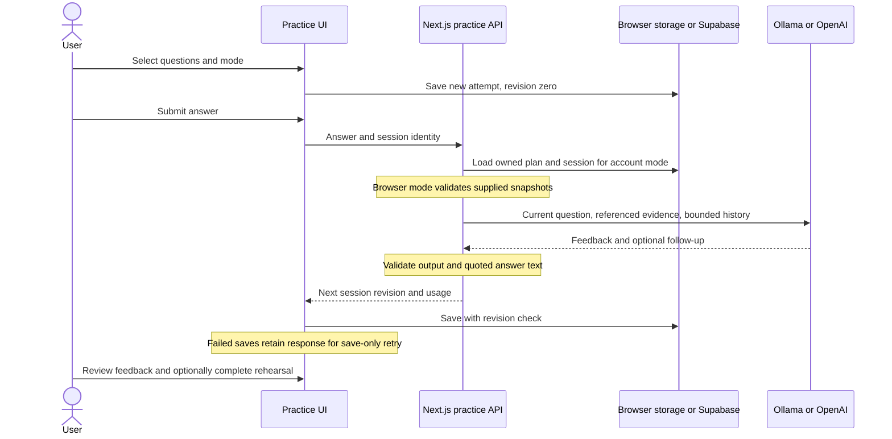

# Conversational interview practice

A practice attempt belongs to an immutable preparation plan version. Start from a question in Interview practice or the questions linked to a Study plan activity. Coach mode shows feedback after each answer; Interview mode reveals it when the attempt ends. Neither changes self-scores. Completing a session offers an explicit action to mark its linked rehearsal complete.

Read top to bottom: the application controls question progression and persistence; the model suggests a follow-up and feedback. A mock contains at most three questions and two follow-ups per question. Each answer is one non-streaming structured call, using existing provider selection, explicit cancellation/deadlines, sanitized errors, no tracing and no retries/fallback. Only the current question's history, requirements and linked experience are sent, bounded to 60,000 serialized characters. Answers are capped at 6,000 characters. Quotes are checked against the answer, which does not establish that the feedback is correct.

Implementation: [session schema/state machine](../../lib/practice-session.ts), [generation](../../lib/practice-generation.ts), [UI](../../components/preparation/interview-session.tsx), [turn route](../../app/api/practice/turn/route.ts), [account persistence](../../app/api/practice/sessions/route.ts).

Browser attempts use `fieldwork-interviews-v1`. Account attempts use `practice_sessions` with an ownership composite foreign key to `preparation_plans`; reads use RLS and writes use an atomic revision-checked RPC. Apply additive migration `006_practice_sessions.sql` after 005. Previous versions are read-only. Target deletion cascades to plans and attempts. Retry of an identical saved revision is a no-op; conflicting saves are rejected. Browser capacity is 100 attempts; account capacity is 100 per plan. Neither silently deletes old attempts.

Hosted calls on the server key have a 60-turn/hour quota. User-supplied keys retain the existing user-pays behavior. Starting, reading and ending attempts need no model call. Feedback uses qualitative suggestions, not hiring predictions or an automated competency score. New claims absent from saved experience should be qualified, not treated as false.

## Evaluation

`pnpm eval:practice` runs labeled synthetic answers against Ollama. Paid providers require explicit `--allow-paid`. Outputs and latency go in ignored `evals/results/`; inspect follow-up relevance, unsupported claims, instruction-following and feedback specificity manually. Passing structural tests does not establish coaching quality.

## Voice direction

The interview state machine is independent of speech input/output. Push-to-talk can transcribe an answer for correction before submission and speak prompts without changing question selection or progress. Full realtime voice is a future alternative: it needs separate interruption, connection, credential and cost controls. See [official voice architecture guidance](https://developers.openai.com/api/docs/guides/voice-agents). No realtime session is implemented here.
