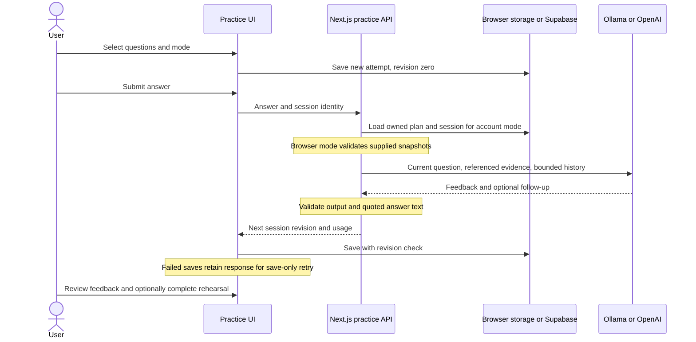

# Conversational interview practice

A practice attempt belongs to an immutable preparation plan version. Start from a question in Interview practice or the questions linked to a Study plan activity. Coach mode shows feedback after each answer; Interview mode reveals it when the attempt ends. Neither changes self-scores. Completing a session offers an explicit action to mark its linked rehearsal complete.

Read top to bottom: the application controls question progression and persistence; the model suggests a follow-up and feedback. A mock contains at most three questions and two follow-ups per question. Each answer is one non-streaming structured call, using existing provider selection, explicit cancellation/deadlines, sanitized errors, no tracing and no retries/fallback. Only the current question's history, requirements and linked experience are sent, bounded to 60,000 serialized characters. Answers are capped at 6,000 characters. Quotes are checked against the answer, which does not establish that the feedback is correct.

Implementation: [session schema/state machine](../../lib/practice-session.ts), [generation](../../lib/practice-generation.ts), [UI](../../components/preparation/interview-session.tsx), [turn route](../../app/api/practice/turn/route.ts), [account persistence](../../app/api/practice/sessions/route.ts).

Browser attempts use `fieldwork-interviews-v1-<scope>`, per owner like practice notes; the older unscoped key moves to the `browser` scope once. Account attempts use `practice_sessions` with an ownership composite foreign key to `preparation_plans`; reads use RLS and writes use an atomic revision-checked RPC. Apply additive migration `006_practice_sessions.sql` after 005. Previous versions are read-only. Target deletion cascades to plans and attempts. Retry of an identical saved revision is a no-op; conflicting saves are rejected. Browser capacity is 100 attempts; account capacity is 100 per plan. Neither silently deletes old attempts.

Hosted calls on the server key have a 60-turn/hour quota. User-supplied keys retain the existing user-pays behavior. Starting, reading and ending attempts need no model call. Feedback uses qualitative suggestions, not hiring predictions or an automated competency score. New claims absent from saved experience should be qualified, not treated as false.

## Notes review

In Self-assess, **Review my notes** sends one question's notes, with that question's sources and evidence from the plan snapshot, to [/api/practice/review](../../app/api/practice/review/route.ts) ([notes-review.ts](../../lib/notes-review.ts)). It is one structured call with the shared [feedback schema](../../lib/feedback.ts); a quote must be an exact substring of the notes. It uses the `practice_turn` hosted quota, so no migration is needed. The result is stored in the plan progress under `reviews[questionId]` with the notes it reviewed, so the UI can say when the notes have changed since. It is shown beside, and never alters, the self-scores.

## Evaluation

`pnpm eval:practice` runs labeled synthetic answers against Ollama. Paid providers require explicit `--allow-paid`. Outputs and latency go in ignored `evals/results/`; inspect follow-up relevance, unsupported claims, instruction-following and feedback specificity manually. Passing structural tests does not establish coaching quality.

## Voice direction

The interview state machine is independent of speech input/output. Push-to-talk can transcribe an answer for correction before submission and speak prompts without changing question selection or progress. Full realtime voice is a future alternative: it needs separate interruption, connection, credential and cost controls. See [official voice architecture guidance](https://developers.openai.com/api/docs/guides/voice-agents). No realtime session is implemented here.

## Implemented push-to-talk

[VoiceAnswer](../../components/preparation/voice-answer.tsx) is a microphone button in the chat composer. It records with MediaRecorder only after the user presses Record answer. It stops at two minutes or 3 MB (about 4 MB once base64-encoded, under Vercel's 4.5 MB request-body limit; limits in [practice-audio-limits.ts](../../lib/practice-audio-limits.ts)), stops tracks on unmount, and retains the audio only in memory. Pressing Record answer is the consent to transcribe that recording: a Meta row beside the button names OpenAI, the model, whose key pays and the per-minute cost before recording starts. One button moves through Record, Stop and transcribe, Cancel and Retry, so keyboard focus stays on it. **Stop and transcribe** sends it once. A failure or cancel keeps the recording in memory with **Retry transcription** and **Discard**; it is never retried automatically. The bounded [transcription route](../../app/api/practice/transcribe/route.ts) uses the normal inference access guard and a separate 30/hour hosted quota. It refuses Ollama configuration rather than falling back. The OpenAI transcription model is `gpt-4o-mini-transcribe`; a user's configured text model is not used for audio. One attempt, 45-second deadline, no retries. Audio is priced from its own table in [pricing.ts](../../lib/pricing.ts), never at text-model prices: an estimate per minute before the call, then its token usage afterwards. Unmapped OpenAI failures report their HTTP status and error code, never OpenAI's message.

The transcript is added to the answer draft in the composer (appended if the draft already has text). It is not sent to the interviewer until the user reviews it and presses **Send answer**. The app does not store raw audio. OpenAI receives the recording when transcription is requested. [ReadAloud](../../components/preparation/read-aloud.tsx) is a speaker button on the current interviewer message. It uses only a device voice marked local, keeps the name "Read question aloud" and reports playing with `aria-pressed`, and stops when the question changes; without such a voice it is hidden. It does not open a realtime voice session.

Permissions-Policy allows microphone access only for the site's own origin, still requiring browser permission. CSP allows same-origin/blob media playback; its network destinations, script rules and PDF worker permissions are unchanged. Browser microphone recording, real OpenAI transcription and audio quality require manual acceptance on the user's device; no paid audio request was made during implementation. Mocked tests cover provider refusal, input bounds, no retries, permission denial and track cleanup.
