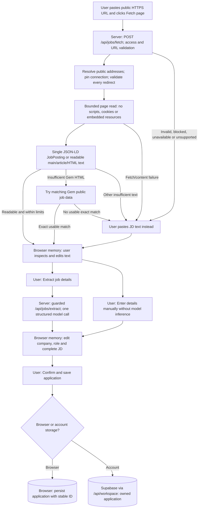
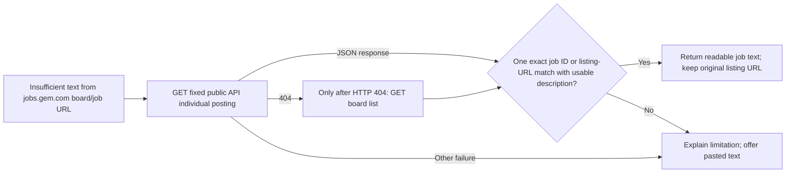

# Job import

[Architecture index](README.md)

## How to read these diagrams

The main path separates page fetching from model extraction. Each is an explicit
user action, and the user can inspect/change text between them. The smaller
diagram expands the Gem recovery path without making it look like general browser
automation or autonomous web search.

## Fetch boundaries and limits

The server accepts public HTTPS on the default port, without URL credentials.
Private/reserved addresses and unsafe redirects are rejected. All resolved
addresses must pass the public-address check; the chosen address is pinned into
the socket lookup while normal TLS hostname verification is retained. Redirects
repeat validation rather than trusting a destination returned by the page.

The fetch budget is 15 seconds overall, three redirects per resource, 2 MB per
response, and 30,000 readable source characters. Gem reads share that same overall
deadline and response bounds. JSON responses are admitted only for the narrowly
recognized Gem API path; general URLs must return supported HTML/text content.
Compressed responses and unsupported types are rejected, not browser-rendered.

This is not Ollama web search: the model does not fetch URLs or discover jobs.
Login walls, anti-bot protection and JavaScript-only content can require manual
paste. Structured data and HTML cleanup are best effort and may omit or retain
unwanted content; users inspect the source before extraction. Gem response shapes
are supported conservatively and have mocked regression coverage, not universal
live-site certification.

## Review, persistence, and cancellation

Only inspected source text goes to the configured model; no experience-bank data
is included. Structured output is validated and kept as an editable draft. Manual
entry bypasses inference. Confirmation validates company, role and a 20–15,000
character JD, creates an application at Saved stage, and stores the listing URL in
notes when a successful fetched source URL is available. The pasted-input path
clears that source URL. Full fetched page text is not saved separately.

A stable creation ID prevents duplicate applications on confirmation retries.
Account retries check owned ID conflicts without overwriting the existing record;
a separate intentional import can still create another application. Failed saves
retain the review. Cancel/unmount aborts fetch/extraction through `AbortController`;
the confirmation callback does not consume that signal, so cancellation cannot
undo a database save. The current save handler also contains a browser
`console.log(fields)` debugging statement; this diagram does not imply a
log-free browser path.

## Implementation

- [Import UI and controller](../../components/job-import.tsx),
  [fetch route](../../app/api/jobs/fetch/route.ts), and
  [network/HTML/Gem handling](../../lib/job-page.ts).
- [Extraction route](../../app/api/jobs/extract/route.ts),
  [structured extraction](../../lib/job-extraction.ts),
  [confirmation and browser persistence](../../components/workspace.tsx), and
  [account creation retry handling](../../app/api/workspace/route.ts).
