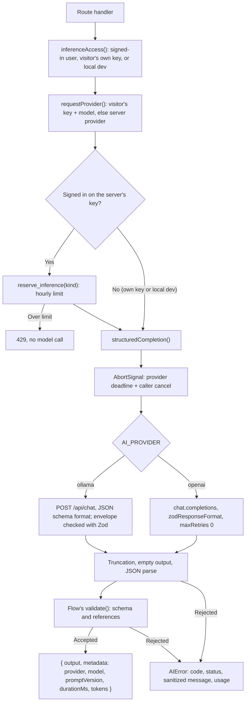

# Model calls

[Architecture index](README.md)

## How to read this diagram

Every inference request follows the same path. Resume extraction, job extraction
and preparation generation each make one structured call through
`structuredCompletion()`. Fit analysis uses the Agents SDK, because it needs
read-only tools, but it follows the same deadline, retry and usage rules.

## Rules this path enforces

- **One attempt.** There are no automatic retries and no provider fallback.
  Ollama failures say that no OpenAI request was made.
- **Deadlines.** 180 seconds for Ollama and 45 seconds for OpenAI. A timeout maps
  to `inference_timeout` (504), and a cancelled request maps to
  `inference_cancelled` (499).
- **Untrusted output.** Model text is parsed and validated before use. Evidence
  and requirement IDs are checked against the inputs, and a preparation plan may
  only cite evidence the model was shown.
- **Sanitized errors.** Provider error bodies are never forwarded, because they can
  echo resume or JD text. Codes follow `<flow>_<reason>`, for example
  `job_invalid_json` or `preparation_truncated`.
- **Usage everywhere.** Successful calls return `metadata` with duration and
  token counts. Failed calls attach the same information as `AIError.usage`, so a
  rejected analysis is still recorded with its real cost.
- **No silent truncation.** Oversized inputs are rejected before the call.
  Over-long outputs, such as a JD above 15,000 characters, get their own error.

## Visitor's own key

`requestProvider(headers)` turns `x-openai-key` and `x-openai-model` into an
OpenAI config for that request. The key is a non-enumerable field, so spreading
or serializing the config never includes it, and `openAIClient()` prefers it to
`OPENAI_API_KEY`. Status reports "your key" without a test call. Calls on a
visitor's key skip the hosted quota. URL fetching (`/api/jobs/fetch`) is never
opened by a key.

Every response, including failures, carries usage with provider and model. The
browser's API client adds each call to a session total, and
[`lib/pricing.ts`](../../lib/pricing.ts) turns tokens into cost and each step's
reply limit into a pre-run ceiling. The same constants set the steps'
`maxTokens`, so the ceiling can't drift from the real limit.

## Hosted quota

[Migration 005](../../supabase/migrations/005_inference_usage.sql) adds an
`inference_usage` ledger and `reserve_inference(kind)`. The hourly limits are:

| Kind                     | Limit per hour |
| ------------------------ | -------------- |
| `resume_extraction`      | 10             |
| `job_extraction`         | 20             |
| `preparation_generation` | 10             |

Fit analysis keeps its own limit of ten per hour in `start_analysis`. A
reservation counts even when the call later fails, as analysis reservations do.
Local development calls without an account are not metered.

## Implementation

- [Shared call path](../../lib/model-call.ts),
  [provider configuration and errors](../../lib/ai-provider.ts),
  [quota helper](../../lib/server.ts).
- Callers: [resume](../../lib/resume-extraction.ts), [job](../../lib/job-extraction.ts),
  [preparation](../../lib/preparation-generation.ts), [fit analysis](../../lib/agent.ts).
- Visitor key and pricing: [provider](../../lib/ai-provider.ts),
  [browser key store](../../lib/user-key.ts), [prices](../../lib/pricing.ts).
- Tests: [wrapper](../../tests/model-call.test.ts),
  [visitor key](../../tests/user-key.test.ts), [pricing](../../tests/pricing.test.ts),
  [key panel and cost hints](../../tests/ui/model-key.test.tsx),
  [quota in Postgres](../../tests/inference-quota.test.ts).
