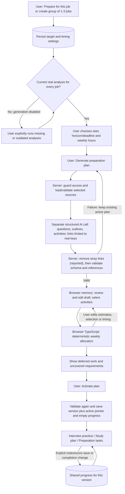
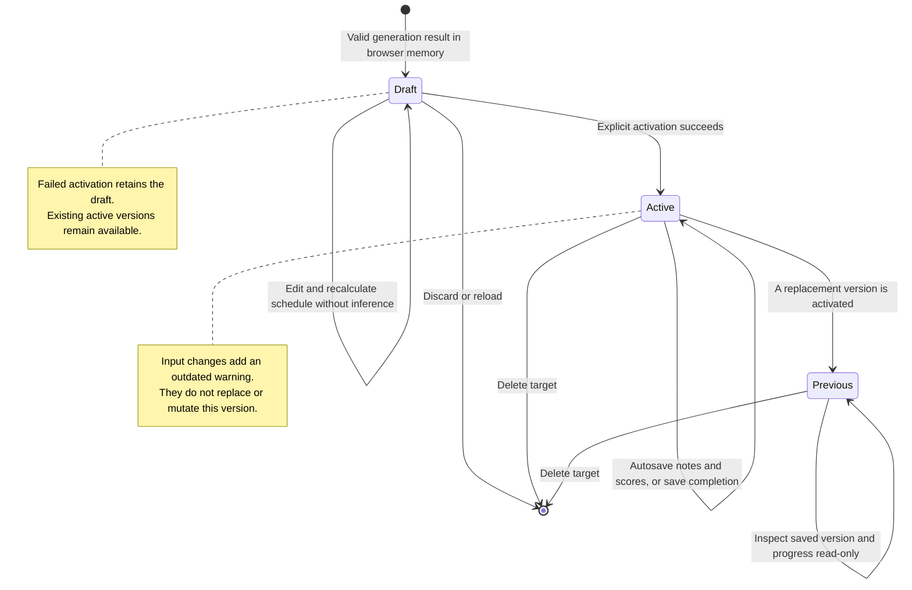

# Preparation lifecycle

[Architecture index](README.md)

## How to read these diagrams

The flowchart shows explicit user actions and where work runs. The state diagram
describes one version's lifecycle. A target can retain an active version while a
replacement draft is being reviewed. The shared target selector changes all three
preparation views without regenerating content.

The validation-failure arrow means **retry is available**, not an automatic model
call. Generate requests use one model call, no tools, the existing provider
deadline, and a 60,000-character serialized-input bound. Oversized input is
rejected without silent truncation. Account generation ignores caller-supplied
workspace snapshots and loads owned data server-side; browser generation accepts
validated snapshots behind the local-development guard.

## What is stored and what is derived

There is **no plan-status enum**. A persisted target's `activeVersionId` identifies
its active version; other versions are displayed as previous/read-only. Drafts
are component state and disappear on discard/reload. `outdated()` compares the
version's settings, membership and source snapshots against current inputs;
unsaved timing edits also produce UI guidance. These are derived views of the
records, not database state transitions stored as strings.

Freshness requires a completed, non-simulated analysis with matching JD and
canonical current experience. Older browser runs without a JD snapshot need
explicit re-analysis. Each plan keeps source analysis IDs, snapshots, SHA-256
fingerprints and provider/model/prompt metadata. Sources changing during review
block new activation; committed activation retries preserve existing records.

## Scheduling and progress

- Links are constrained, then repaired. The model's output schema only accepts
  link keys that exist (`jobId#requirementId`, cited `jobId#evidenceId`). Any link
  that still doesn't resolve is removed, items left without a real requirement
  are dropped, and the draft review lists each repair. A plan with no usable
  question or activity is rejected with a specific reason.
- Defaults: one week and 12 hours/week; users can choose two weeks or a specific
  inclusive interview date, with 0.5–40 hours/week. Partial weeks are prorated.
- Activities are indivisible, estimated at 5–120 minutes, and allocated to the
  first weekly bucket with capacity, by priority with stable ordering for ties.
  A large activity can be deferred while a smaller later activity fits.
- Edits and scheduling happen locally without another AI call. Excluded work is
  omitted; selected work that cannot fit is shown as deferred. Coverage records
  scheduled requirement references, not demonstrated skill mastery.
- Questions, outlines and activities are in the immutable version payload.
  Notes/self-scores and completion are in separate progress keyed by stable item
  IDs. Saving an answer does not mark a rehearsal complete.
- Activation writes version, initial progress and active pointer together in the
  account RPC; browser mode persists a complete validated state before updating
  React. Failed saves retain review. New versions start fresh progress; earlier
  notes and completion are not automatically transferred.

General practice stays separate with its fixed questions and browser-local
progress. Earlier analysis tasks are filtered to the selected jobs and excluded
from new-plan time totals. Deleting an application retains preparation snapshots
and leaves missing target membership to repair; deleting a target removes its
versions and progress. See the [data model](data-model.md).

## Implementation

- [Target/review/practice UI](../../components/preparation-workspace.tsx) and
  [its parts](../../components/preparation/),
  [general practice](../../lib/sample-practice.ts), and
  [source validation, scheduling and local activation](../../lib/preparation-plan.ts).
- [Generation route](../../app/api/preparation/generate/route.ts),
  [generation call](../../lib/preparation-generation.ts),
  [link keys and repair](../../lib/plan-links.ts),
  [owned-source loading](../../lib/preparation-server.ts), and
  [account persistence route](../../app/api/preparation/route.ts).
- [Transactional account storage](../../supabase/migrations/004_preparation_targets.sql).
