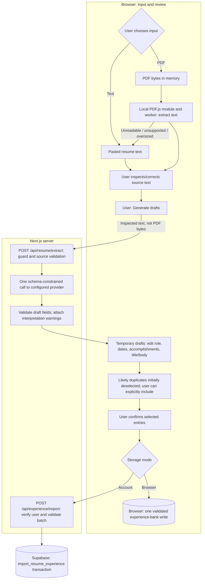

# Resume import

[Architecture index](README.md)

## How to read this diagram

Parsing and inference are separate. PDF bytes never go to the application API;
only inspected source text does. All model output remains an editable proposal
until the user explicitly confirms selected experience entries.

## Input, model output, and saved records

| Stage            | Data and lifetime                                                                                                                                                                            |
| ---------------- | -------------------------------------------------------------------------------------------------------------------------------------------------------------------------------------------- |
| PDF parsing      | One text-based PDF, up to 5 MB and ten pages; PDF bytes stay in browser memory. The module, worker, fonts and related assets are served locally.                                             |
| Inspected source | Up to 20,000 characters, with optional parser page text. Source validation checks source/page consistency; this is not model citation matching.                                              |
| Extraction       | One role per explicitly listed job role or standalone project, with empty missing fields and warnings. No tools, OCR or DOCX support.                                                        |
| Review           | Up to 30 drafts; structured fields map into existing title/body experience records. The user can select, edit, or cancel.                                                                    |
| Confirmation     | Selected title/body, role/project metadata, provider/model/prompt metadata, confirmation time and stable batch/item IDs are saved. Original PDF and full inspected source are not persisted. |

New imports do not request or require resume quotations or page citations. Optional
legacy provenance passages remain compatible. Validation checks shapes and bounds;
the user must check the truth of dates, metrics, ownership and accomplishments.

Likely duplicates use normalized title/body, or organization/role/date metadata
when both records have it. Matches are deselected rather than overwritten or
merged. Explicitly including a duplicate is allowed as a separate record.

## Failures, retry, and capacity

Encrypted, scanned, malformed or empty PDFs show errors; potentially incomplete
extraction can show warnings. Multi-column reading order still needs inspection.
Oversized input is rejected rather than silently truncated. Pasted text is the
fallback when automatic PDF parsing cannot recover useful text.

The experience bank is limited to 50 entries. Local import validates the selection
and persists the resulting bank before closing. Account import validates every
entry and inserts the batch transactionally through the database function, with
ownership checks, uniqueness and capacity protection. Stable batch/item identifiers
make retries idempotent rather than overwriting already imported entries.

Inference errors preserve inspected source for explicit retry. Failed confirmation
retains review drafts. Cancel/reload discards unconfirmed drafts. Abort signals
cancel extraction requests where supported; they do not roll back committed saves.

## Implementation

- [Import UI](../../components/resume-import.tsx),
  [PDF module/worker loader](../../lib/pdf-browser.ts),
  [PDF text policies](../../lib/pdf-text.ts), and
  [draft/import/duplicate rules](../../lib/resume.ts).
- [Extraction route](../../app/api/resume/extract/route.ts),
  [structured model call](../../lib/resume-extraction.ts), and
  [confirmed account import](../../app/api/experience/import/route.ts).
- [Transactional import and capacity](../../supabase/migrations/002_resume_import.sql)
  plus [citation-free import update](../../supabase/migrations/003_resume_without_citations.sql).
