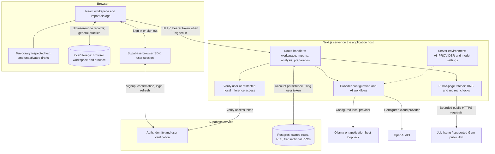

# System overview

[Architecture index](README.md)

## How to read this diagram

Boxes are execution or persistence boundaries. Solid arrows are calls or writes;
dotted arrows are configuration. The browser does not call a model provider
directly. Supabase Auth and the database serve different roles.

## Independent choices

| Choice             | Current implementation                                                                                                                               |
| ------------------ | ---------------------------------------------------------------------------------------------------------------------------------------------------- |
| Storage            | Signed out uses browser records; signed in uses owned Supabase records. Signing in does not upload browser records.                                  |
| Inference          | `AI_PROVIDER` selects Ollama or OpenAI for the server. A visitor may instead send their own OpenAI key and model per request. No automatic fallback. |
| General practice   | Static questions/roadmap and browser-local notes, scores, and checkboxes, isolated by browser/account key.                                           |
| Target preparation | Targets, immutable plan versions, and progress use browser storage or Supabase according to the session.                                             |

`/api/analyze/local` means the browser-workspace analysis path, not an Ollama-only
provider. Browser storage + OpenAI and Supabase + Ollama are both supported code
paths. Unauthenticated inference requires explicit local-workspace opt-in,
development execution, loopback hosting, same origin, and the forwarding/hosting
checks in the server guard. Hosted use requires authentication or the visitor's
own OpenAI key (`x-openai-key`), which unlocks every model route except URL
fetching. Because that key sits in browser storage, pages carry a nonce-based
Content-Security-Policy set per request in `proxy.ts`.

Ollama's `127.0.0.1` refers to the **Next.js server's machine**. Deploying Next.js
does not give it access to a model running on the user's laptop. OpenAI readiness
only checks that a key is configured; Ollama readiness checks installed model
metadata. Neither is a successful end-to-end inference test.

AI workflows have different responsibilities: resume/job extraction use single
structured calls, fit analysis uses a bounded agent, and preparation generation
uses a separate structured call followed by deterministic TypeScript scheduling.

## Implementation

- [Page entry](../../app/page.tsx), [layout](../../app/layout.tsx),
  [workspace shell](../../components/workspace.tsx) with its
  [views](../../components/views/), [shell parts](../../components/shell/),
  [dialogs](../../components/modals/) and [hooks](../../components/hooks/);
  [preparation workspace](../../components/preparation-workspace.tsx) and its
  [parts](../../components/preparation/).
- [Client data layer](client-data.md) and [model calls](model-calls.md).
- [Access guards and errors](../../lib/server.ts),
  [provider configuration](../../lib/ai-provider.ts), and
  [non-secret readiness endpoint](../../app/api/ai/status/route.ts).
- [Workspace persistence API](../../app/api/workspace/route.ts) and
  [preparation persistence API](../../app/api/preparation/route.ts).
